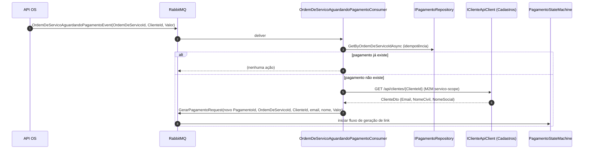

# Mensageria

## SAGA `PagamentoStateMachine`

| Estado | Eventos aceitos |
| --- | --- |
| `Initial` | `GerarPagamentoRequest`, `MercadoPagoCallbackRecebidoRequest`, `VerificarStatusPagamentoRequest` |
| `Processing` | Apenas `OperationCompleted/Failed/TimedOut`; novas requests são descartadas (`Ignore`) |

A correlação é feita por `PagamentoId` (CorrelationId). Persistência da SAGA: `MongoDbRepository`
da `MassTransit.MongoDb` na coleção `pagamento-saga-state` (database `MONGODB__SAGA_DATABASE`).

## Contratos

### Requests (HTTP/Webhook → SAGA)

- `GerarPagamentoRequest(PagamentoId, OrdemDeServicoId, ClienteId, EmailCliente, NomeCliente, Valor, Vencimento)`
- `MercadoPagoCallbackRecebidoRequest(PagamentoId, MercadoPagoEventId, MercadoPagoStatus)`
- `VerificarStatusPagamentoRequest(PagamentoId)` (delayed, agendado pelos consumers)

### Execute commands (SAGA → Consumer)

- `ExecuteGerarLinkPagamento`
- `ExecuteMercadoPagoCallback`
- `ExecuteConfirmarPagamento(PagamentoId, Via)`
- `ExecuteRecusarPagamento(PagamentoId, Motivo)`
- `ExecuteExpirarPagamento(PagamentoId)`
- `ExecuteVerificarStatusPagamento(PagamentoId)`

### Events (Consumer → SAGA)

- `PagamentoOperationCompleted(PagamentoId, Operacao)`
- `PagamentoOperationFailed(PagamentoId, Operacao, Motivo)`
- `PagamentoOperationTimedOut(PagamentoId, Operacao)` (agendado)

### Integration (cross-service)

Os contratos legados foram substituídos por integration events com `[EntityName]` canônico (veja seção [Contratos migrados](#contratos-migrados-para-entityname-canônico) abaixo). Os contratos atuais são:

| EntityName | Classe | Direção | Payload |
| --- | --- | --- | --- |
| `pagamento.confirmado` | `PagamentoConfirmadoEvent` | **Publica** → API de OS | `OrdemDeServicoId`, `PagamentoId`, `ConfirmadoEm` |
| `pagamento.recusado` | `PagamentoRecusadoEvent` | **Publica** → API de OS | `OrdemDeServicoId`, `PagamentoId`, `Motivo`, `RecusadoEm` |
| `pagamento.link-gerado` | `LinkPagamentoGeradoEvent` | **Publica** → API de Cadastros | `PagamentoId` |
| `ordem-de-servico.aguardando-pagamento` | `OrdemDeServicoAguardandoPagamentoEvent` | **Consome** ← API de OS | `OrdemDeServicoId`, `ClienteId`, `Valor` |

## Contratos migrados para `[EntityName]` canônico

Os contratos legados foram removidos e substituídos por integration events com decorator `[EntityName]`, alinhando o roteamento MassTransit pelo nome canônico em vez do namespace .NET:

| Contrato legado (removido) | Substituto | EntityName |
| --- | --- | --- |
| `PagamentoAprovadoRequest` (namespace OS) | `PagamentoConfirmadoEvent` | `pagamento.confirmado` |
| `PagamentoRecusadoIntegrationEvent` | `PagamentoRecusadoEvent` | `pagamento.recusado` |
| `EnviarEmailPagamentoCommand` | `LinkPagamentoGeradoEvent` | `pagamento.link-gerado` |

O principal motivador foi eliminar o namespace-alignment hack (`PagamentoAprovadoRequest` no namespace da API de OS), que acoplava o código de Pagamentos ao namespace de OS.

## Integration Events (Cross-Service)

### Eventos publicados

| Consumer que publica | Evento | Quando |
| --- | --- | --- |
| `GerarLinkPagamentoConsumer` | `LinkPagamentoGeradoEvent` | Após link gerado no Mercado Pago e `MarcarEmailEnviado` |
| `ConfirmarPagamentoConsumer` | `PagamentoConfirmadoEvent` | Após `Confirmar(via)` bem-sucedido |
| `MercadoPagoCallbackConsumer` | `PagamentoConfirmadoEvent` | Webhook MP com status `approved` |
| `VerificarStatusPagamentoConsumer` | `PagamentoConfirmadoEvent` | Polling retornou `Approved` |
| `RecusarPagamentoConsumer` | `PagamentoRecusadoEvent` | Após `Recusar(motivo)` bem-sucedido |
| `ExpirarPagamentoConsumer` | `PagamentoRecusadoEvent` | Após `Expirar()` bem-sucedido |
| `VerificarStatusPagamentoConsumer` | `PagamentoRecusadoEvent` | Polling retornou `Rejected`/`Cancelled`/`Expired` |

### `OrdemDeServicoAguardandoPagamentoConsumer`

Consumer cross-service que reage ao evento publicado pela API de OS quando uma ordem avança para `AguardandoPagamento`. Inicia a criação do pagamento na SAGA local.

**Fluxo:**

**Idempotência:** antes de publicar `GerarPagamentoRequest`, o consumer verifica se já existe um `Pagamento` para o `OrdemDeServicoId` via `IPagamentoRepository.GetByOrdemDeServicoIdAsync`. Se já existir, a mensagem é descartada silenciosamente.

**Autenticação M2M:** a consulta ao Cadastros usa `IClienteApiClient` (HTTP client configurado com `CADASTROS_API__BASE_URL`). O token M2M deve ter `servico-scope`. Em ambiente de desenvolvimento, o `DevelopmentAuthenticationMiddleware` do Cadastros aceita qualquer requisição.

## Outbox em MongoDB

Coleção `pagamento_outbox` com schema `{ _id, type, payload, status, retryCount, lastError, createdAt, processedAt, claimedBy, claimedAt, traceContext }`.

- **Claim atômico:** `MongoOutboxProcessor` faz `FindOneAndUpdate(status=Pending, ClaimedBy=null OR ClaimedAt<ttl)` setando o instance id e timestamp. Múltiplas réplicas competem sem double-delivery.
- **DLQ:** após `MaxRetries` consecutivas, status vira `DeadLettered` e a mensagem não é reprocessada.
- **Cleanup:** `MongoOutboxCleanupService` remove documentos `Processed` mais antigos que `OUTBOX__PROCESSED_RETENTION_DAYS` (default 7d).
- **Discriminador estável:** `[DomainEventName("...")]` no Domain Event grava um nome lógico em vez de `AssemblyQualifiedName`.

## Pipeline do Consumer (MassTransit)

- `UseMessageRetry` — retry imediato 3× com 2s para `TimeoutException`/`HttpRequestException`.
- `UseDelayedRedelivery` — exponencial (15s → 2min, 3 tentativas) para falhas mais persistentes.
- `UseInMemoryOutbox` — garantia "tudo ou nada" entre publish + commit dentro do consumer.
- `PagamentoCommandValidationFilter<T>` — descarta mensagens com `PagamentoId == Guid.Empty` sem retry.
