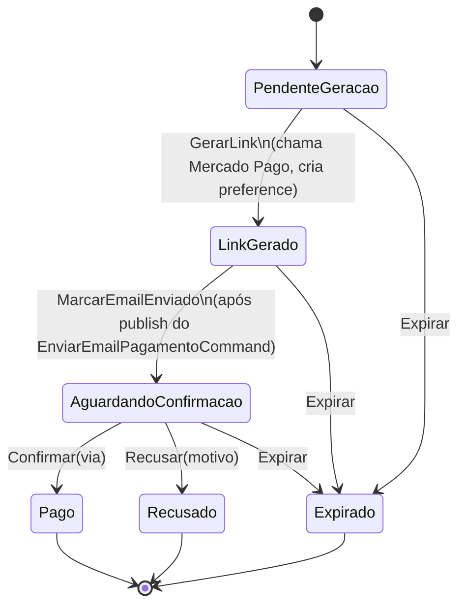

# Fluxo de Pagamento

## Máquina de estados

`PendenteGeracao` e `LinkGerado` também aceitam `Expirar` (timeout de geração ou link vencido).
`Pago`, `Recusado` e `Expirado` são terminais (`IsTerminal == true`).

## Gatilho cross-service — `OrdemDeServicoAguardandoPagamentoEvent`

Além do endpoint REST, o ciclo de pagamento pode ser iniciado automaticamente quando a **API de OS** avança uma ordem para o estado `AguardandoPagamento`. O evento `OrdemDeServicoAguardandoPagamentoEvent` carrega `OrdemDeServicoId`, `ClienteId` e `Valor`, eliminando a necessidade de um trigger manual.

O `OrdemDeServicoAguardandoPagamentoConsumer` reage ao evento, consulta os dados do cliente na API de Cadastros via M2M (`IClienteApiClient`) e publica `GerarPagamentoRequest` na SAGA local, iniciando o mesmo fluxo descrito abaixo.

Para detalhes do consumer, veja [`messaging.md#ordemdeservicoaguardandopagamentoconsumer`](./messaging.md#ordemdeservicoaguardandopagamentoconsumer).

## Ciclo end-to-end

1. **Início:** `POST /api/pagamentos` (trigger manual) **ou** `OrdemDeServicoAguardandoPagamentoEvent` (trigger automático via OS) → `GerarPagamentoRequest` no bus → SAGA inicia
2. **SAGA** correlaciona por `PagamentoId`, agenda timeout de 5 min, publica `ExecuteGerarLinkPagamento`, transita para `Processing`
3. **`GerarLinkPagamentoConsumer`** cria o agregado, chama o Mercado Pago, aplica `GerarLink` + `MarcarEmailEnviado`, persiste, publica `LinkPagamentoGeradoEvent` e agenda o **primeiro polling** (`VerificarStatusPagamentoRequest` daqui a `PAGAMENTO__POLLING_INTERVAL`)
   - `LinkPagamentoGeradoEvent` é consumido pela API de Cadastros → envia e-mail com link ao cliente
4. **Confirmação dupla:**
   - **Webhook:** `POST /api/webhooks/mercadopago` valida HMAC + idempotência, publica `MercadoPagoCallbackRecebidoRequest`. SAGA dispara `ExecuteMercadoPagoCallback`. `MercadoPagoCallbackConsumer` confirma/recusa o pagamento e publica `PagamentoConfirmadoEvent` ou `PagamentoRecusadoEvent` (cross-service).
   - **Polling:** `VerificarStatusPagamentoConsumer` consulta o MP. Se ainda `pending`, reagenda outra verificação enquanto `TentativasVerificacao < LimiteVerificacoes`. Quando atinge o limite, expira o pagamento.
5. **Callback à OS:**
   - **Confirmado:** publica `PagamentoConfirmadoEvent { OrdemDeServicoId, PagamentoId, ConfirmadoEm }` → `PagamentoConfirmadoConsumer` na OS avança a ordem para `PagamentoConfirmado`
   - **Recusado/Expirado:** publica `PagamentoRecusadoEvent { OrdemDeServicoId, PagamentoId, Motivo, RecusadoEm }` → `PagamentoRecusadoConsumer` na OS reverte a ordem para `ManutencaoFinalizada`

## Idempotência

- **Webhook:** unique constraint em `webhook_events.MercadoPagoEventId`. Retransmissões caem fora silenciosamente.
- **Mercado Pago:** header `X-Idempotency-Key = PagamentoId` na criação da preference para tolerar retries.
- **Confirmação:** se `MercadoPagoCallbackConsumer` recebe webhook approved e o agregado já está `Pago`, apenas reemite o `PagamentoAprovadoRequest` (defensivo) e completa.

## Timeout sentinel

A SAGA agenda `PagamentoOperationTimedOut` ao entrar em `Processing`. Após `OperationTimeoutDelay` (default 5 min), se não houver `OperationCompleted`/`Failed`, a SAGA volta para `Initial` registrando o motivo no `UltimoMotivoFalha` da instância da SAGA.
